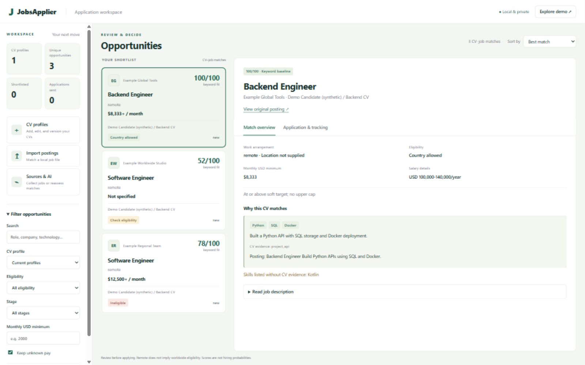

# Jobs Applier v2 - your local job review workspace

A configurable workflow for software engineering, full-stack, .NET/backend, applied/agentic AI, and mobile roles. Supports separate CV profiles for team members. Current personal defaults: Pakistan-based, remote preferred, relocation allowed, roughly USD 2,000/month gross as a soft target, worldwide employers, and no upper salary cap.

**Working now:** JSON/JSONL/CSV and saved JobPosting JSON-LD imports; public Greenhouse/Lever board adapters; local SQLite deduplication and profile-aware caching; evidence-linked keyword baseline; optional structured OpenAI/local Ollama assessment; review-only letter drafts; HTML/CSV/JSON reports; per-profile application tracking. The keyword baseline is not AI or a hiring probability.

## Interactive dashboard

```powershell
python dashboard.py
```

Open http://127.0.0.1:8765 to add labeled CV profiles, import postings, review evidence-backed matches, filter salary/eligibility, edit/version CV profiles, collect public postings, use opt-in AI, save/download drafts, and track application stages and notes. Start with **Explore synthetic demo**. The dashboard uses a separate private local database and uses local matching by default. External collection and AI require explicit controls; applications are submitted manually. See the [dashboard guide](docs/DASHBOARD.md) for supported formats and limitations.

## Start in under a minute

```powershell
# Dependency-free demo; all people/jobs are synthetic.
python main.py run --profile examples/demo_profile.json --input examples/jobs.json
# Open output/index.html to review the shortlist.

# Create your own private target profile, then provide your actual CV.
python main.py init-profile profiles/hassan.remote.json
python main.py run --profile profiles/hassan.remote.json --cv "C:/path/to/your/software-cv.txt" --input examples/jobs.json
```

Text CVs work with Python's standard library. PDF extraction additionally requires `pdfplumber`; scanned PDFs need text extraction/OCR before this workflow. Example jobs are synthetic and must not be treated as vacancies.

See [QUICK_START.md](QUICK_START.md) for live employer boards, multiple profiles, status tracking, and opt-in AI. See [current architecture](docs/LOCAL_FIRST_V2.md) and [implementation status](docs/PLAN.md).

## Practical boundaries

- Remote does not imply worldwide eligibility. Explicit country restrictions, unknown eligibility, and relocation/work authorization are flagged separately.
- Known USD annual salaries are divided by 12. Hourly pay is not annualized without contracted hours. Non-USD pay is not converted with guessed exchange rates. Missing/below-target salaries stay visible.
- AI requires an explicit model, global job cap, and global call budget. Hosted OpenAI requires an environment API key; local Ollama requires an installed runtime/model. No paid API requests were made during development; provider transports are fixture-tested. Real-model semantic quality has not yet been measured. Quotation validation checks source support, not semantic truth or overall suitability.
- Local reports contain private CV excerpts: keep them private. External collection and AI inference are explicit opt-ins. No automatic application submission, messages, or Google Sheets writes occur in v2.
- Greenhouse live smoke check succeeded on 5 November 2026. Lever is fixture-tested; its live behavior was not verified. Pangian's live probe returned a non-JSON response and is currently unreliable. Collectors are bounded and report outages.

## Reproducible ranking benchmark

The [JobFit v1 benchmark](benchmarks/jobfit_v1/README.md) adds 60 authored postings, five fictional CVs, and 300 provisional judgments, with family-separated development/test splits. It compares title-only and keyword ranking and reports ranking, eligibility, compensation, quote support, latency, and failures.

```powershell
python benchmark.py validate
python benchmark.py evaluate --split dev
python benchmark.py annotations --output output/reviewer.csv
```

These are synthetic scenarios, not real-world AI-quality evidence or human-rated applications. The worksheet supports independent review without exposing provisional answers. See the [benchmark protocol](benchmarks/jobfit_v1/README.md) for grading and held-out discipline, and the [measured baseline report](docs/BENCHMARK_RESULTS.md) for current results and failures.

## Ownership and provenance

This portfolio repository is maintained under `Hassan043`. The modular v2 workflow and authored benchmark are the maintained implementation. Historical scripts and personal assets are preserved locally but excluded from the clean repository. See [provenance](docs/PROVENANCE.md).

## Portal expansion

Run `python main.py portals` for the source inventory, or filter with `--group` / `--country`. The [coverage matrix](docs/PORTAL_COVERAGE.md) distinguishes maintained adapters, documented APIs, manual imports, reference resources, and unverified research entries.

Read-only Remotive and Arbeitnow adapters passed live smoke checks on 6 November 2026 (three valid postings each) and available through `--feeds remotive arbeitnow`, with attribution, bounded requests, local caching, and cooldowns. Most listed portals do not yet have a native connector. No account scraping or automatic applications were added.

## Portfolio tour

See the [demo walkthrough](docs/PORTFOLIO_DEMO.md), [release validation](docs/RELEASE_VALIDATION.md), and [free local AI setup](docs/FREE_LOCAL_AI.md).


