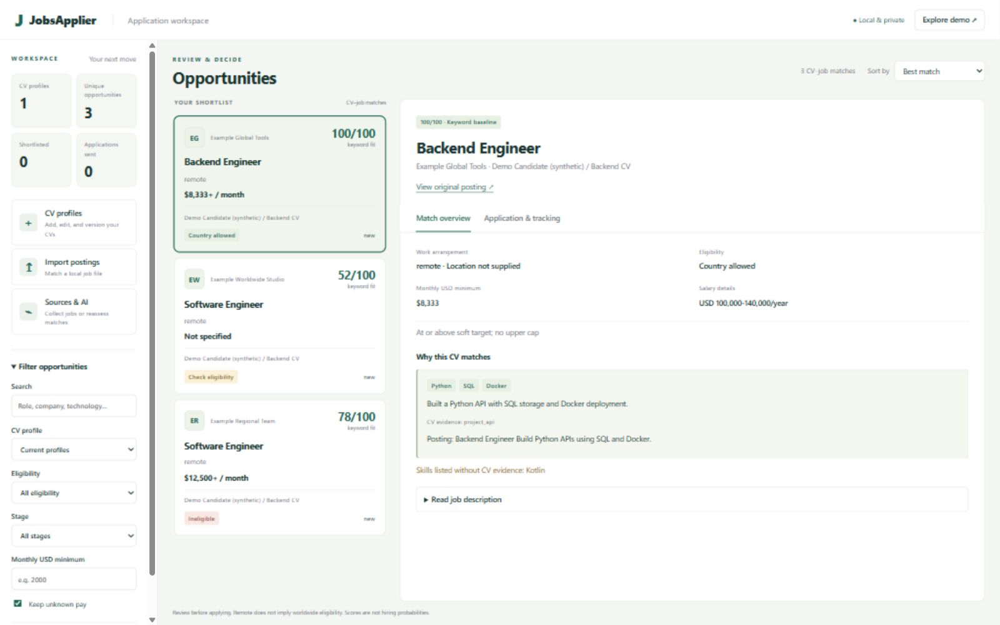

# JobsApplier portfolio demo

JobsApplier brings multiple CV variants and fragmented job postings into a local review workflow: collect/import, compare evidence, check pay and eligibility, prepare a grounded draft, and track a manual application.

**Stack:** Python standard library HTTP server and SQLite; vanilla JavaScript, HTML, CSS; optional OpenAI SDK or local Ollama HTTP inference; optional pdfplumber for selectable-text PDFs. The core demo runs without a frontend build, hosted database, paid account, or external call.

[Watch the silent interface tour](media/walkthrough.mp4). This is a screenshot-based tour of real UI states using synthetic data. It does not demonstrate actual LLM inference or application submission.

## Two-minute live walkthrough

| Time | Demonstration | Engineering point |
|---|---|---|
| 0:00–0:20 | Start the dashboard and Explore demo. | Reproducible synthetic demo; private local state. |
| 0:20–0:45 | Filter country eligibility and pay; open a job. | Remote is not worldwide eligibility; unknown pay is retained. |
| 0:45–1:05 | Show grouped CV/job excerpts and a missing-evidence warning. | Evidence provenance is separate from an inferred suitability score. |
| 1:05–1:25 | Open Application & tracking, edit/save a draft, save a stage. | Persistent job/CV-specific state; no external submission. |
| 1:25–1:45 | Load and edit a CV profile; show retained previous revision. | Versioned candidate identity avoids silently mixing CV histories. |
| 1:45–2:00 | Open Sources & AI, show providers and hard call caps, then the benchmark report. | Explicit external access, local model option, measurable limitations. |

Only demonstrate live inference after installing/configuring the selected provider and validating its outputs. Never pretend the keyword baseline is an LLM or that fixture tests prove semantic quality.

## Interview discussion

The interesting decisions are conservative eligibility/pay handling, immutable analysis identities, quote validation beyond JSON schema, bounded external calls, honest provider failures, source caching/attribution, preserved CV/draft revisions, and a desktop layout that separates filtering, scanning, and decisions.

The current benchmark has 60 authored postings, 5 fictional CVs, and 300 provisional labels, with family-separated dev/test cases. Existing measured results compare title-only and keyword matching; independent labels and actual provider-quality evaluation are the next validation milestone, not a completed claim.

## Screenshots

- [Desktop review workspace](media/overview.png)
- [Application and tracking](media/application.png)
- [Source and AI controls](media/sources.png)
- [Mobile layout](media/mobile.png)

See [architecture](LOCAL_FIRST_V2.md), [benchmark results](BENCHMARK_RESULTS.md), [release checks](RELEASE_VALIDATION.md), and [local AI setup](FREE_LOCAL_AI.md). Keep real CVs, keys, notes, and live posting exports out of public demo assets.
